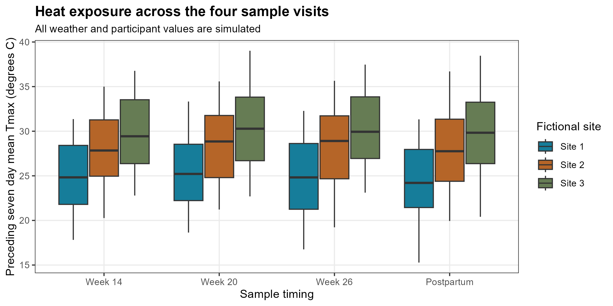
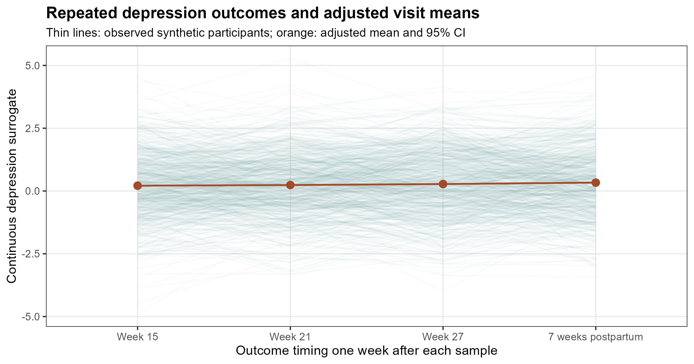
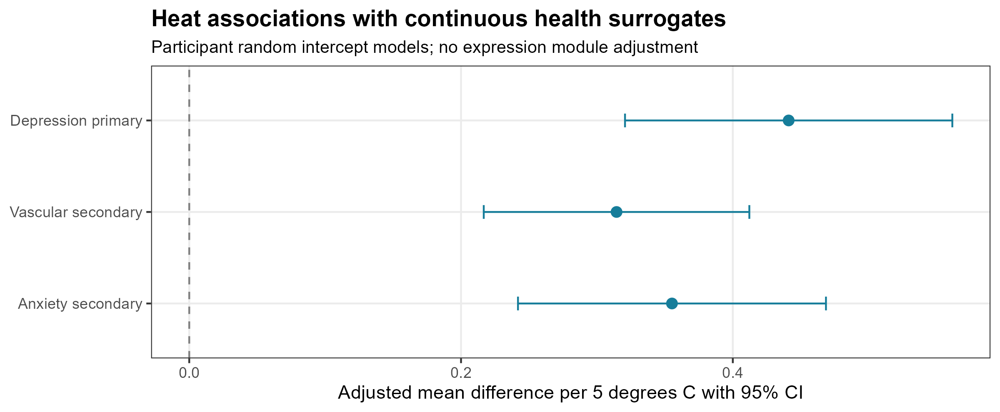
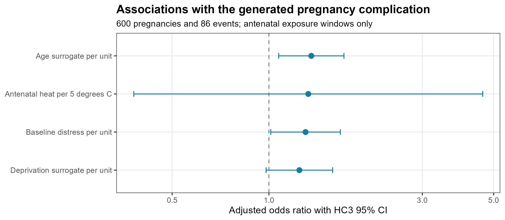
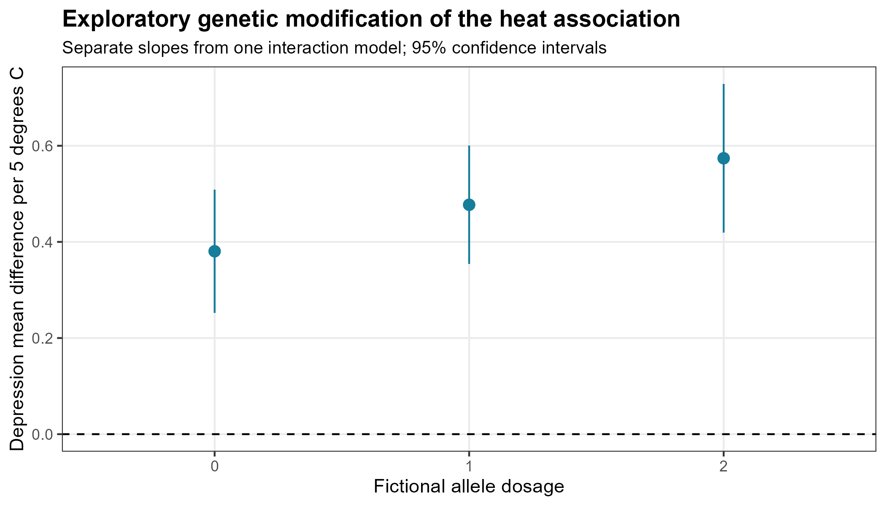
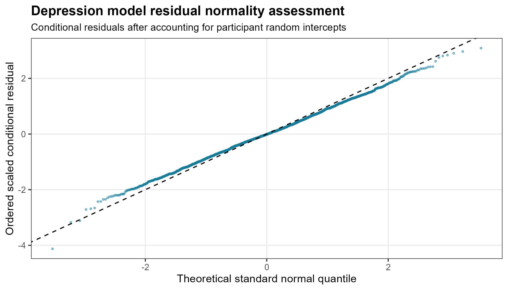
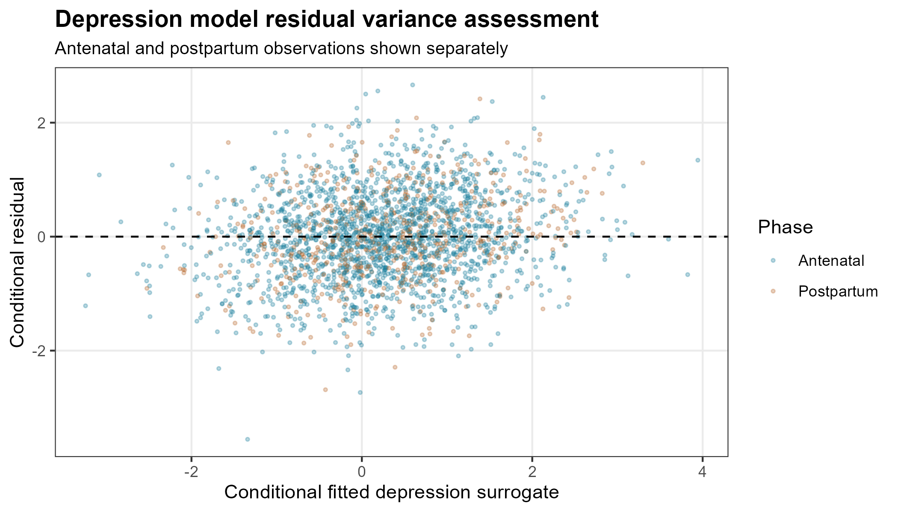
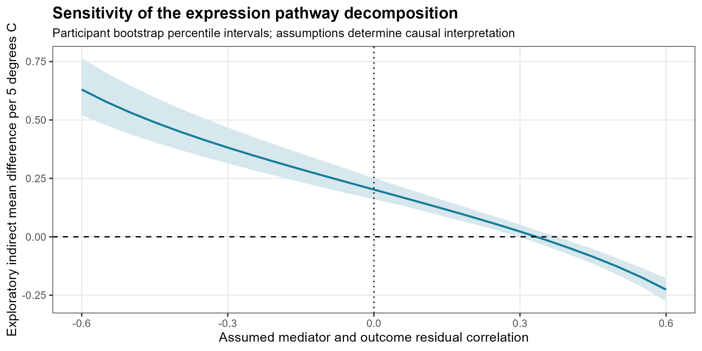
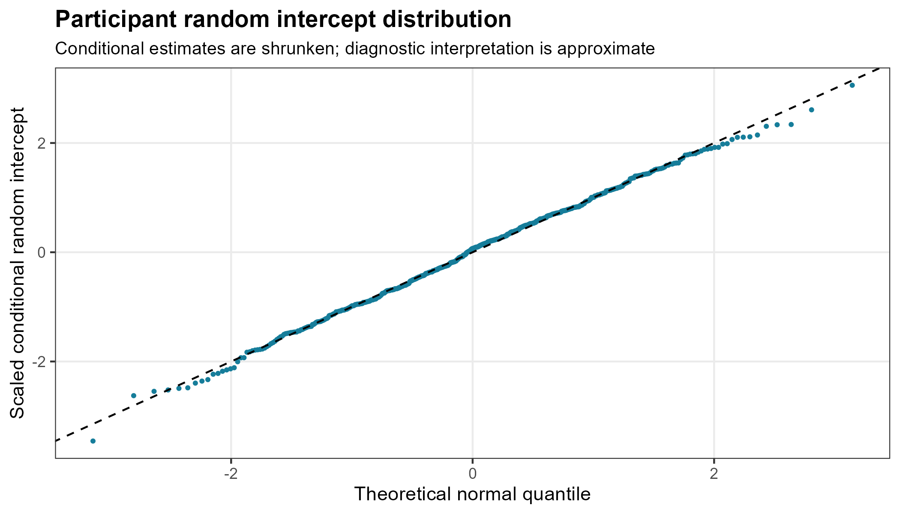

# Heat exposure and maternal health surrogates in a simulated longitudinal cohort

**Vusumuzi Mabasa**

**Entirely simulated data | Applied epidemiological analysis in R | 26 November 2026**

[Word manuscript](output/docx/heat_pregnancy_simulation_report.docx) | [PDF manuscript](output/pdf/heat_pregnancy_simulation_report.pdf) | [R workflow](run_epidemiology.R) | [Original Bayesian manuscript](archive/bayesian-study-v2/README.md)

## Abstract

**Background.** Repeated measurements can distinguish associations with continuous maternal health traits from associations with a pregnancy complication. An epidemiological analysis also needs explicit exposure timing and an appropriate account of measurements from the same woman.

**Objective.** To investigate associations between heat exposure and repeated depression, vascular and anxiety surrogates, and a separately generated pregnancy complication, in an entirely synthetic cohort.

**Methods.** The original 600-woman cohort was retained with 2,400 complete visits. Exposure was the mean daily maximum temperature over seven completed days before each sample. Continuous outcomes were assessed seven days after sampling. The primary outcome was the continuous depression surrogate. Participant random intercept models estimated adjusted mean differences per 5 degrees C, with visit, fictional site, baseline covariates, genotype and season adjustment. Logistic regression examined the complication using antenatal exposure windows only. R produced the analysis, ggplot figures, gtsummary tables and native Word flextables. Secondary analyses examined within-person heat, genetic modification and an exploratory expression pathway decomposition.

**Results.** Higher heat was associated with a depression mean difference of 0.44 (95% CI 0.32 to 0.56) per 5 degrees C. Vascular and anxiety differences were 0.31 (95% CI 0.22 to 0.41) and 0.36 (95% CI 0.24 to 0.47). The complication odds ratio was 1.33 (95% CI 0.38 to 4.63). There were 86 complications among 600 women (14.3%).

**Conclusion.** Higher heat exposure was associated with higher continuous health surrogates in this generated cohort. The complication association remained uncertain. These findings describe synthetic data and provide no evidence about clinical risks in actual pregnant women.

## Introduction

Maternal heat exposure is an important environmental health question. Published pregnancy research has associated higher temperatures with several adverse birth outcomes [1], but that literature does not establish effects on the fictional outcomes studied here. A useful analysis must define the population, the timing of exposure, the outcome scale and the role of repeated observations before interpreting coefficients.

This study considers a longitudinal cohort with environmental, molecular and health measurements. The data are entirely simulated, including the weather. A continuous depression score surrogate is different from a clinical diagnosis; an expression module is different from an identified biological mediator; and a generated complication is different from a documented obstetric diagnosis. Those distinctions determine what the analysis can answer.

### Aim and objectives

The aim was to estimate the adjusted association between heat exposure and the repeated continuous depression surrogate. Secondary objectives were to describe vascular and anxiety associations, assess the separate pregnancy complication association, investigate genetic and postpartum modification, and explore an expression pathway while assessing its assumptions. The emphasis is the analysis of one fixed cohort, rather than comparing algorithms or estimating simulation power.

## Methods

### Design and population

The existing synthetic cohort comprised 600 women at three fictional sites, with 200 women per site. Each woman had samples at gestational weeks 14, 20 and 26, and six weeks after a fixed week-40 delivery. Outcomes followed each sample by seven days, corresponding to weeks 15, 21 and 27 and seven weeks postpartum. One postpartum measurement does not describe an entire postpartum trajectory.

The analysis reuses the original saved cohort. No participant, outcome, seed or effect parameter was changed to obtain a preferred result. The primary outcome and adjustment structure were defined for this epidemiological refocus; this was not a preregistered or blinded analysis. The original Bayesian results, posterior draws and feature screen remain unchanged, with their prior manuscript and code preserved under `archive/bayesian-study-v2`.

### Data preparation and measurement audit

R verified participant keys, four visits per woman, visit ordering, within-woman invariance of baseline covariates, binary complication coding and the mapping of raw fictional dosage to the original centred genotype. All 2,400 visits were complete for the analysis variables; there were no duplicated woman-visit keys, exclusions or newly imputed values. An independent calculation reconstructed 80 distributed exposure windows from the saved daily weather panel and agreed within numerical tolerance. The machine-readable audit and analysis datasets are retained in `results/epidemiology`.

Age, deprivation, ancestry and baseline distress are continuous synthetic surrogates. Actual age in years is unavailable, and deprivation is not binary. Their coefficients therefore refer to one stored surrogate unit. The outcome names contain `_z`, but results are reported in stored surrogate units; they are not necessarily one empirical standard deviation of this cohort. The generic complication is coded 0 for absence and 1 for presence. The original generator-only vascular random intercept was excluded from every analysis dataset and model.

### Heat exposure and temporal ordering

For sample day $s_{iv}$ of woman $i$ at visit $v$, daily maximum temperature $T$ defined exposure

$$
H_{iv}=\frac{1}{7}\sum_{j=1}^{7}T_{iv}(s_{iv}-j),\qquad X_{iv}=H_{iv}/5.
$$

The sample day was excluded. Because the health outcome occurred on $s_{iv}+7$, the temperature window covered days 14 through 8 before that outcome. It was not the seven days immediately before the outcome. The exposure contrast was 5 degrees C. Weather, sites, neighbourhood labels and calendar dates were synthetic; the study used neither real ERA5 observations nor actual recruitment sites. Neighbourhood labels have no geographical coordinates or adjacency, so spatial models and maps were not justified.

### Continuous outcome association models

The primary model was

$$
Y_{iv}=\alpha+\beta_H X_{iv}+\boldsymbol\eta^{\mathsf T}V_v+
\boldsymbol\gamma^{\mathsf T}C_i+\boldsymbol\delta^{\mathsf T}S_i+
\theta_1\sin(2\pi s_{iv}/365.25)+\theta_2\cos(2\pi s_{iv}/365.25)+u_i+\epsilon_{iv},
$$

where $Y_{iv}$ was the depression surrogate, $V_v$ categorical visit, $C_i$ age, deprivation, ancestry, baseline distress and centred genotype, and $S_i$ two fixed site indicators. The participant intercept followed $u_i\sim N(0,\tau^2)$ and conditional residuals followed $\epsilon_{iv}\sim N(0,\sigma^2)$. The model assumes an adequate conditional mean, independent participants and conditional within-participant residual independence. Fixed site indicators adjusted mean site differences; three sites were not treated as a sufficient basis for site-clustered robust standard errors.

Models were fitted by restricted maximum likelihood using lmerTest and lme4 [2,3]. Confidence intervals and two-sided tests used Satterthwaite degrees of freedom. The coefficient $\beta_H$ represents an adjusted mean difference per 5 degrees C. The expression module was omitted from these primary models to avoid conditioning on the proposed pathway. Accordingly, these are total adjusted associations, not automatically causal total effects. Identical models addressed vascular and anxiety surrogates, with Holm correction across those two secondary heat tests. The depression heat test was the designated primary test.

A visit-adjusted-only model assessed the contribution of the full adjustment set. Antenatal-only analysis excluded the postpartum visit. A within-between sensitivity model replaced $X_{iv}$ by the participant mean $\bar X_i$ and deviation $X_{iv}-\bar X_i$. Its within-person coefficient asks whether a woman had a higher outcome when her heat exposure was higher relative to her own average, conditional on visit and seasonal terms. This does not eliminate time-varying confounding.

### Pregnancy complication model

The complication was recorded once per woman at fixed day 280 after conception. There were no onset dates, and all deliveries were fixed at week 40 in the generator. The outcome therefore supports neither a survival analysis nor a preterm-birth analysis. Antenatal exposure was the arithmetic mean of the three antenatal seven-day windows, not a whole-pregnancy average. Postpartum measurements were excluded.

With $D_i$ denoting complication status and $\bar X_{i,A}$ the antenatal exposure, the model was

$$
\log\left\{\frac{\Pr(D_i=1)}{1-\Pr(D_i=1)}\right\}
=a+b_H\bar X_{i,A}+\boldsymbol c^{\mathsf T}Z_i.
$$

The adjustment vector contained age, deprivation, ancestry, baseline distress, site indicators and mean antenatal seasonal sine and cosine. Nine slope parameters were retained for 86 events; no stepwise selection was used. Odds ratios were $\exp(b)$ with HC3 sandwich Wald 95% confidence intervals, not risk ratios or posterior odds. The expression module was excluded from this association model.

### Secondary modification and expression pathway analyses

Two separate depression models added heat by centred genotype or heat by postpartum phase. Formal interaction tests compared maximum likelihood fits; their two p values received Holm correction. The genotype was a fictional dosage with no real gene or variant interpretation. Genotype-specific heat slopes were derived from one interaction model, rather than inferred by comparing significance in separate groups.

An exploratory expression analysis fitted

$$
M_{iv}=a_0+a_HX_{iv}+a_GG_i^c+a_{HG}X_{iv}G_i^c+\boldsymbol a_C^{\mathsf T}W_{iv}+e_{M,iv},
$$

$$
Y_{iv}=c_0+c_HX_{iv}+c_GG_i^c+c_{HG}X_{iv}G_i^c+b_MM_{iv}+\boldsymbol c_C^{\mathsf T}W_{iv}+u_i+e_{Y,iv}.
$$

Both equations used the same baseline, visit, site and seasonal covariates. The mediator equation was ordinary linear regression and the outcome equation included a participant random intercept. Inference resampled whole women, retaining all four visits; repeated draws received distinct bootstrap identifiers. The average product pathway was $(a_H+a_{HG}\overline{G^c})b_M$, the remaining direct association was $c_H+c_{HG}\overline{G^c}$, and their algebraic sum was the decomposed total. It need not equal the coefficient from the primary model, which omits genotype interaction.

Three hundred participant bootstrap resamples produced percentile confidence intervals. These quantify uncertainty conditional on the fitted path models; they are not repeated new cohorts or an assessment of power. The decomposition requires correct temporal and model specification for a causal interpretation, together with consistency, adequate exposure support and no unmeasured exposure-outcome, exposure-mediator or mediator-outcome confounding. It does not implement a longitudinal causal g-formula for exposure-induced time-varying confounding [4]. No mediated proportion was emphasised.

A working residual-correlation sensitivity varied $\rho$ from -0.6 to 0.6. It replaced $b_M$ by $b_M-\kappa(\rho)$, where

$$
\kappa(\rho)=\frac{\rho\sigma_Y}{\sigma_M\sqrt{1-\rho^2}}.
$$

This is a linear sensitivity device, not an identified correction or proof of a natural indirect effect. It shows how dependence between otherwise unmeasured mediator and outcome disturbances can change the pathway interpretation.

### Diagnostics and reporting

Checks covered convergence, singular random effects, residual-versus-fitted patterns, residual and random-intercept quantiles, and generalised variance inflation. Heat and age functional forms were assessed by comparing linear terms with three-degree-of-freedom natural splines using maximum likelihood, not comparisons of restricted likelihoods with different fixed effects. A nonsignificant diagnostic does not prove an assumption.

The logistic model was checked for full rank, finite estimates and complete or quasi separation using linear programming. Cook distances described influence. Every eligible woman remained in the main analysis; omitting the five largest values was reported only as a sensitivity. Preprocessing, models, statistical tables, diagnostics and figure generation were performed in R. Native Word tables used gtsummary and flextable, figures used ggplot2, and Quarto generated the manuscript. The prior Python Bayesian analysis was preserved rather than relabelled as this R analysis.

## Results

### Cohort and exposure distribution

There were 600 women, 2,400 visits and 86 complications (14.3%). All three sites contributed 200 women and all four visits contributed 600 outcomes. Baseline summaries below use one record per woman. Differences by eventual complication status are descriptive and were not used to select predictors. Values are mean (SD) or number (percent).

**Table 1 Baseline characteristics by subsequent complication status**

| **Characteristic** | **Overall**  <br>N = 600 | **No complication**  <br>N = 514 | **Complication**  <br>N = 86 |
| --- | --- | --- | --- |
| __Fictional site__ |  |  |  |
| Site 1 | 200 (33%) | 180 (35%) | 20 (23%) |
| Site 2 | 200 (33%) | 174 (34%) | 26 (30%) |
| Site 3 | 200 (33%) | 160 (31%) | 40 (47%) |
| __Fictional allele dosage__ |  |  |  |
| 0 | 283 (47%) | 245 (48%) | 38 (44%) |
| 1 | 254 (42%) | 218 (42%) | 36 (42%) |
| 2 | 63 (11%) | 51 (9.9%) | 12 (14%) |
| __Age surrogate__ | -0.03 (1.00) | -0.07 (1.01) | 0.24 (0.93) |
| __Deprivation surrogate__ | 0.27 (1.00) | 0.22 (1.02) | 0.54 (0.85) |
| __Ancestry score__ | -0.03 (0.99) | -0.08 (0.98) | 0.28 (1.00) |
| __Baseline distress__ | 0.08 (1.05) | 0.03 (1.04) | 0.39 (1.08) |
| __First visit heat in degrees C__ | 27.59 (4.25) | 27.31 (4.23) | 29.27 (4.00) |
| __First depression outcome__ | 0.20 (1.36) | 0.14 (1.36) | 0.60 (1.32) |

Temperature varied across the three fictional sites and across visits. These variations provide the observed exposure contrasts, but site and seasonal adjustment also reduce the independent heat information available for estimating the complication association.



The visit table describes the actual stored outcome scales. The postpartum observation is a distinct phase and was not treated as an additional gestational week.

**Table 2 Observed visit summaries**

| Visit | N | Heat | Depression | Vascular | Anxiety |
| --- | --- | --- | --- | --- | --- |
| Week 14 sample | 600 | 27.59 (4.25) | 0.20 (1.36) | 0.14 (1.05) | 0.08 (1.21) |
| Week 20 sample | 600 | 27.91 (4.32) | 0.26 (1.33) | 0.25 (1.09) | 0.20 (1.23) |
| Week 26 sample | 600 | 27.77 (4.49) | 0.29 (1.39) | 0.26 (1.01) | 0.22 (1.24) |
| Six week postpartum sample | 600 | 27.30 (4.37) | 0.31 (1.36) | 0.03 (1.04) | 0.26 (1.27) |

### Primary depression association

Higher heat exposure was associated with a depression mean difference of 0.44 (95% CI 0.32 to 0.56) per 5 degrees C (p <0.001). Secondary vascular and anxiety associations were also positive: 0.31 (95% CI 0.22 to 0.41) and 0.36 (95% CI 0.24 to 0.47). Both remained below 0.05 after Holm correction across the two secondary outcomes. These estimates describe the generated health scales, not clinical diagnoses.

**Table 3 Adjusted heat associations with continuous outcomes**

| Outcome | Adjusted mean difference (95% CI) | P | Secondary Holm P |
| --- | --- | --- | --- |
| depression | 0.44 (0.32, 0.56) | <0.001 |  |
| vascular | 0.31 (0.22, 0.41) | <0.001 | <0.001 |
| anxiety | 0.36 (0.24, 0.47) | <0.001 | <0.001 |

The individual trajectories show substantial participant-to-participant variation. Adjusted means hold the model covariates at their reference grid, including average heat, continuous covariates and equal weighting across sites. They do not show the effect of an intervention or imply that an individual woman's outcome must follow the adjusted line.



The association plot separates the designated primary depression outcome from the secondary vascular and anxiety outcomes. All three outcomes are continuous surrogates, so the estimates are mean differences rather than odds ratios.



The full primary model table shows the adjustment set and uncertainty in its coefficients. Site 1, the first sample visit and the centred genotype reference are the relevant comparison levels. Baseline covariate coefficients are conditional associations, not independently established causal effects.

**Table 4 Full adjusted depression model**

| **Characteristic** | **Mean difference** | **95% CI** | **p-value** |
| --- | --- | --- | --- |
| __Heat per 5 degrees C__ | 0.441 | 0.321, 0.562 | <0.001 |
| __Sample visit__ |  |  |  |
| Week 14 sample |  |  |  |
| Week 20 sample | 0.026 | -0.071, 0.124 | 0.597 |
| Week 26 sample | 0.065 | -0.032, 0.163 | 0.190 |
| Six week postpartum sample | 0.123 | 0.025, 0.221 | 0.014 |
| __Age surrogate__ | -0.007 | -0.078, 0.065 | 0.851 |
| __Deprivation surrogate__ | 0.211 | 0.137, 0.285 | <0.001 |
| __Ancestry score__ | 0.031 | -0.044, 0.106 | 0.420 |
| __Baseline distress__ | 0.470 | 0.401, 0.539 | <0.001 |
| __Fictional site__ |  |  |  |
| Site 1 |  |  |  |
| Site 2 | 0.071 | -0.121, 0.264 | 0.468 |
| Site 3 | 0.158 | -0.062, 0.378 | 0.160 |
| __Season sine__ | 0.063 | -0.008, 0.134 | 0.083 |
| __Season cosine__ | -0.080 | -0.198, 0.038 | 0.182 |
| __Genotype per allele__ | 0.099 | -0.009, 0.208 | 0.072 |

### Sensitivity and model assumptions

The antenatal-only depression estimate was 0.46 (95% CI 0.32 to 0.60) per 5 degrees C. The within-person estimate was 0.44 (95% CI 0.32 to 0.57), while the between-person estimate was 0.42 (95% CI 0.18 to 0.66). The similar within-person result supports consistency of the association across these working specifications, without proving freedom from time-varying confounding.

**Table 5 Depression association sensitivity analyses**

| Analysis | Mean difference (95% CI) | P |
| --- | --- | --- |
| Visit adjusted only | 0.42 (0.37, 0.47) | <0.001 |
| Fully adjusted | 0.44 (0.32, 0.56) | <0.001 |
| Antenatal visits only | 0.46 (0.32, 0.60) | <0.001 |

The depression model was nonsingular and converged, with an intraclass correlation of 0.45. The heat spline comparison gave p 0.327 and the age-surrogate comparison p 0.066; neither met the 0.05 threshold. Heat shared substantial information with site and season: its one-degree-of-freedom variance-inflation factor was 6.67. Residual quantiles were approximately linear centrally, with some tail departures. Residuals against fitted values showed no prominent curvature or funnel. These visual findings support the working mean and variance structure but do not verify conditional independence. Residual and random-intercept plots are supplied below.

### Pregnancy complication association

The adjusted complication odds ratio per 5 degrees C higher antenatal heat was 1.33 (95% CI 0.38 to 4.63) (p 0.658). The interval includes both appreciably lower and higher odds; the data do not support a precise direction or magnitude. Age-surrogate association was 1.35 (95% CI 1.07 to 1.71) per stored unit, which cannot be translated into years. The model converged without detected separation. Omitting the five largest Cook distances gave a heat OR of 2.23 (95% CI 0.70 to 7.16) among 595 women with 81 events; all 600 women remain in the primary model.

**Table 6 Adjusted associations with the pregnancy complication**

| **Characteristic** | **OR** | **95% CI** | **p-value** |
| --- | --- | --- | --- |
| __Antenatal heat per 5 degrees C__ | 1.33 | 0.38, 4.63 | 0.658 |
| __Age surrogate__ | 1.35 | 1.07, 1.71 | 0.011 |
| __Deprivation surrogate__ | 1.24 | 0.98, 1.58 | 0.073 |
| __Ancestry score__ | 1.38 | 1.06, 1.80 | 0.016 |
| __Baseline distress__ | 1.30 | 1.01, 1.67 | 0.039 |
| __Fictional site__ |  |  |  |
| Site 1 |  |  |  |
| Site 2 | 1.05 | 0.38, 2.88 | 0.929 |
| Site 3 | 1.34 | 0.32, 5.63 | 0.692 |
| __Mean season sine__ | 1.27 | 0.64, 2.53 | 0.490 |
| __Mean season cosine__ | 1.47 | 0.45, 4.77 | 0.526 |

The forest plot presents the heat association alongside selected covariate associations. Its wide heat interval should be interpreted as limited precision in this cohort, rather than evidence that the complication has the same relationship with heat as the continuous outcomes.



### Genetic modification and postpartum phase

The heat-by-genotype likelihood-ratio test gave p 0.007 and Holm-adjusted p 0.014. Estimated depression slopes increased across fictional dosage 0, 1 and 2: 0.38, 0.48 and 0.57 per 5 degrees C. This concerns a deliberately synthetic genotype, not a discovered variant. The heat-by-postpartum test gave p 0.574 (Holm p 0.574), providing no clear evidence of a phase difference in this cohort; it does not establish identical antenatal and postpartum effects.



### Exploratory expression pathway

The exploratory product pathway through the expression module was 0.20 (95% CI 0.16 to 0.25) depression-surrogate units per 5 degrees C. Its percentile interval used 300 valid participant resamples out of 300 requested; 0 fits failed or did not converge. This is a conditional statistical decomposition, not proof of a biological mechanism. The primary heat association and the pathway estimate answer different questions, and a significant total association is not a prerequisite for estimating the pathway.

**Table 7 Exploratory expression pathway decomposition**

| Component | Mean difference (95% bootstrap CI) |
| --- | --- |
| indirect | 0.20 (0.16, 0.25) |
| direct | 0.23 (0.10, 0.36) |
| total | 0.43 (0.30, 0.55) |

## Discussion

This analysis found positive adjusted heat associations with continuous depression, vascular and anxiety surrogates in a fixed synthetic cohort. The depression result was similar when limited to antenatal observations and when separating within-person heat from average exposure. The distinct complication model produced a much less precise heat association. The difference between these findings is informative: more repeated continuous information does not create additional independent pregnancy complications.

The genotype interaction describes modification within a deliberately structured simulation, with no claim about a real molecular marker. The expression pathway is also exploratory. Temporal ordering is present in the saved data, but causal mediation depends on assumptions that ordering alone cannot establish. A positive product pathway does not demonstrate that changing a real expression module would change maternal health.

Important limitations arise from the dataset itself. The data were generated with heat associations and expression pathways, so their presence is not new epidemiological evidence. Participants are fictional, measurement error and dropout are absent, there is no clinical diagnostic validation, and baseline scores do not reproduce a complete confounder set. Seasonal heat and fictional site share information, particularly for the three-window antenatal average. The model assumes independent women conditional on its structure; real studies may need additional environmental, household or healthcare clustering. The residual-correlation analysis is only a working linear sensitivity and does not resolve time-varying confounding. Three hundred bootstrap resamples provide an exploratory interval with finite Monte Carlo precision.

For real data, the same workflow would first require actual age, measured heat linkage, validated trait instruments, complication definitions and onset dates, recruitment dates, missing-data provenance, socioeconomic and obstetric confounders, and measurement quality checks. A documented causal diagram should guide adjustment. Exposure timing and a missing-data plan should be fixed before model fitting. Larger cohorts or more events may improve complication precision, but replacing the endpoint or searching for a significant model would not solve the underlying information limit.

## Conclusion

In this entirely synthetic cohort, higher seven-day heat exposure was associated with higher repeated continuous health surrogates. Evidence for a pregnancy complication association was inconclusive. The study demonstrates a complete R association workflow with transparent preprocessing, outcome-appropriate models, diagnostics and cautious pathway interpretation. It provides no estimated clinical risk, validated biomarker or public-health recommendation for actual populations.

## Supplementary diagnostics

The following table records model checks and the disclosed influence sensitivity. Original main analysis records were retained. More detailed residuals, coefficient tables, package versions, bootstrap statuses and source-preservation checks are saved with the results.

**Table S1 Model diagnostics and influence sensitivity**

| Check | Finding |
| --- | --- |
| Depression random intercept fit | ICC 0.45; singular: FALSE |
| Clinical logistic fit | Converged; design rank 10 of 10 |
| Complete or quasi separation | Absent by linear programming |
| Heat functional form | ML spline comparison p 0.327 |
| Age functional form | ML spline comparison p 0.066 |
| Participant bootstrap | 300 of 300 converged resamples |
| Influence sensitivity | Omitting five largest Cook distances: clinical heat OR 2.23 (0.70, 7.16) |

The conditional residual quantiles assess the Gaussian working distribution after accounting for participant intercepts. The reference line aids visual assessment; it is not a formal acceptance criterion.



Residuals are also plotted against conditional fitted values, with antenatal and postpartum records distinguished. Systematic curvature or changing spread would indicate a need to revisit the mean or residual variance structure in real data.



The pathway sensitivity curve shows the estimated indirect association and participant-bootstrap interval as assumed residual correlation changes. A curve that crosses zero illustrates the dependence of a mechanistic interpretation on untestable disturbance assumptions.



Conditional random-intercept quantiles provide an additional approximate diagnostic, recognising that these estimated intercepts are shrunken towards zero.



## Reproducibility and data availability

All records are synthetic and already included. No downloads, credentials, ERA5 access or new cohort simulation are required for the R analysis. Run the following from the repository root after installing the listed R packages. Package versions and session information used for this release are recorded in `results/epidemiology/R_packages.csv` and `R_sessionInfo.txt`.

```r
install.packages(c("lme4", "lmerTest", "gtsummary", "flextable", "officer",
  "sandwich", "car", "jsonlite", "broom.mixed", "ggplot2", "emmeans",
  "lpSolve", "dplyr", "knitr", "digest", "rmarkdown"))
```

```bash
Rscript --vanilla run_epidemiology.R
Rscript --vanilla run_epidemiology.R --report
```

The second command additionally requires Quarto and renders the Word manuscript. A full run includes 300 participant bootstrap resamples and takes longer than the core association fits. Results are deterministic conditional on package/platform numerical behaviour and the recorded seed. The existing Python code and original outputs remain available for reproducing the historical analysis; the R command is the entry point for this epidemiological manuscript. README, tables and Quarto source are regenerated from the same fitted R results. Word-to-PDF export on Windows is available through `export_manuscript.ps1`.

The analysis code is organised as preprocessing, association models, secondary analyses, tables and figures, manuscript generation and validation. `epidemiology_config.json` records the analysis version and bootstrap settings. The checked source cohort and legacy results are protected by `provenance/original_results_sha256.json`; validation permits only Git line-ending normalisation for text files. No original scientific result was overwritten by the R outputs.

## References

1. Chersich MF and colleagues. Associations between high temperatures in pregnancy and risk of preterm birth low birth weight and stillbirths. BMJ 2020;371:m3811. [Article](https://www.bmj.com/content/371/bmj.m3811).
2. Bates D, Maechler M, Bolker B, Walker S. Fitting linear mixed effects models using lme4. Journal of Statistical Software 2015;67(1):1-48. [Article](https://doi.org/10.18637/jss.v067.i01).
3. Kuznetsova A, Brockhoff PB, Christensen RHB. lmerTest package tests in linear mixed effects models. Journal of Statistical Software 2017;82(13):1-26. [Article](https://doi.org/10.18637/jss.v082.i13).
4. VanderWeele TJ, Vansteelandt S, Robins JM. Effect decomposition in the presence of an exposure induced mediator outcome confounder. Epidemiology 2014;25(2):300-306. [Article](https://doi.org/10.1097/EDE.0000000000000034).

