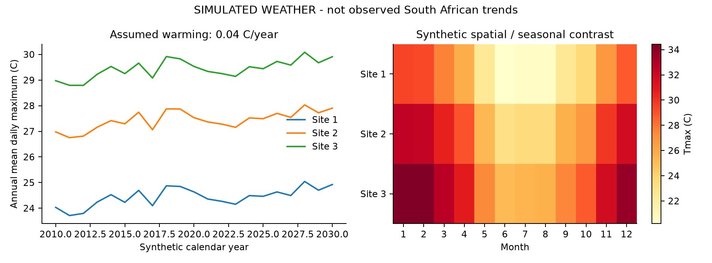
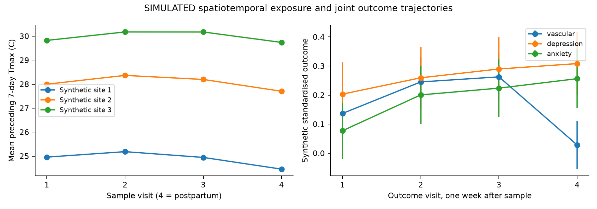
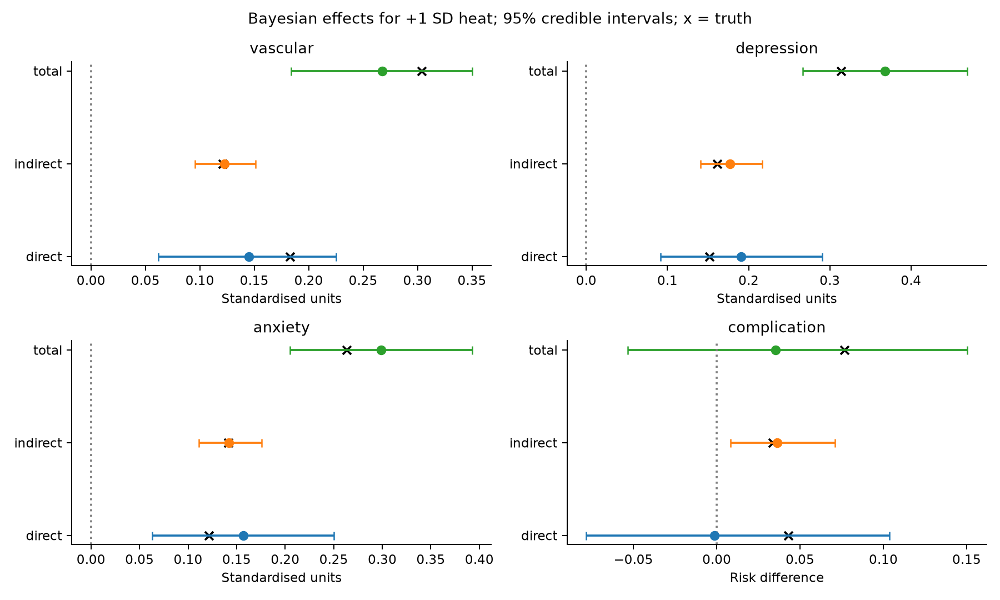
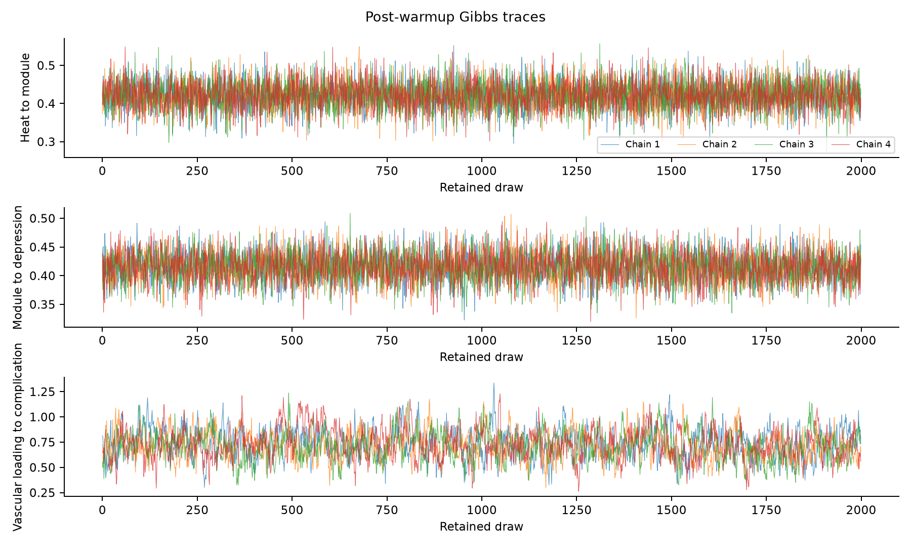
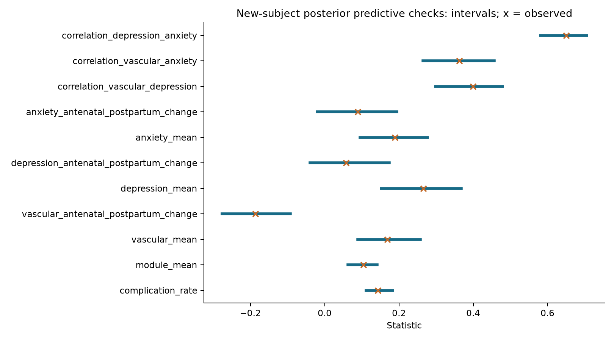
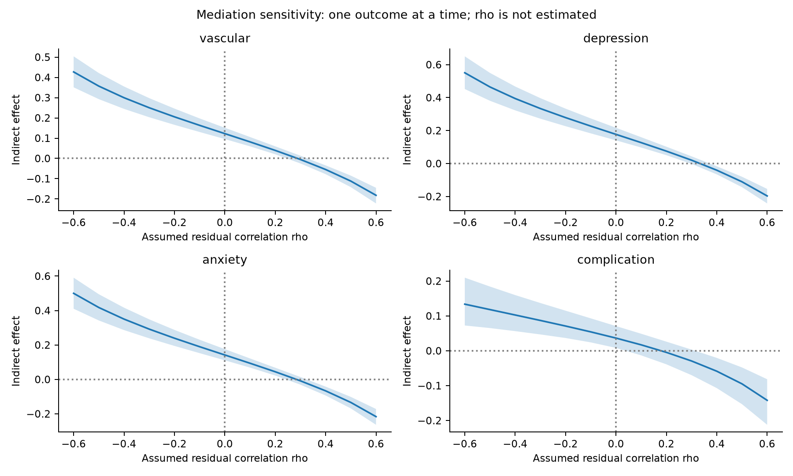

# Heat exposure, maternal and mental health: a joint Bayesian simulation

Genetic susceptibility and transcriptomic mediation in a purpose-built prospective South African study

Prepared for Vusi | 23 October 2026 | Version 2.0

## SIMULATED DATA - NOT EMPIRICAL FINDINGS

All weather, participants, outcomes, genotypes and expression measures are generated. No real participants were recruited. No susceptibility gene, clinical risk estimate or South African climate trend has been discovered. The model tests recovery of deliberately imposed effects and the sensitivity of conclusions to assumptions.

## What was completed

The new cohort contains 600 synthetic women, four paired molecular/outcome visits per woman, and 86 generated later pregnancy complications. A Bayesian model jointly fits vascular, depression and anxiety trajectories and the binary complication endpoint. Three four-chain fits assess the base model, wider priors and module measurement error. The report also includes residual-confounding sensitivity and a separate 500-feature transcriptomic scan.

## Principal numerical result

For a hypothetical +1 SD heat shift, the population-average depression indirect effect is 0.177 (0.141, 0.217) standardised units. The complication indirect effect is 3.64 (0.83, 7.09) percentage points. These estimates are conditional on the assumed model and no unmeasured mediator-outcome confounding.

## How the result should inform the grant

Keep Dr Glory Chidumwa's spatiotemporal exposure programme as the foundation. Build a new, seasonally balanced cohort around measured exposure contrasts, then collect timed mental-health, maternal-health and molecular measurements. Treat genetic modification and transcriptomic mediation as distinct questions. The simulation demonstrates computational feasibility, not adequate sample size or causal identification in a real study.

The earlier 1,500-person preterm-birth demonstration and 7,200 scenario fits are retained as a separate legacy analysis. They are not merged with this new cohort. Genomic SEM remains a possible external-summary-statistics work package and has not been run.

# 1. Background, research question and objectives

The supplied fellowship launch programme describes a one-year research and career-development period addressing heat exposure, maternal health and mental health [1]. Vusi clarified that Dr Glory's initial scientific focus was spatiotemporal heat-exposure trends. This context motivates the sequence: characterise exposure patterns, design a prospective cohort, then investigate clinical and molecular susceptibility.

Reviews associate high temperatures with adverse pregnancy outcomes, while documenting heterogeneous metrics and settings [2,3]. Bio-HEAT proposes maternal biological-pathway research [4], and HE2AT provides relevant exposure and data-science expertise [5]. These sources motivate the study; the numerical effects in this simulation are analyst-selected assumptions, not literature-calibrated estimates.

## Research question

How are spatial and temporal variations in environmental heat exposure associated with maternal physical-health outcomes and depression and anxiety trajectories during pregnancy and postpartum in South Africa, and to what extent does inherited genetic variation modify these associations and transcriptomic responses mediate selected effects?

## Three connected analyses

1. Maternal health: estimate heat associations with repeated vascular measurements and a later pregnancy-complication endpoint.
2. Mental health: estimate heat associations with repeated depression and anxiety severity, accounting for shared individual variation.
3. Molecular susceptibility: estimate genetic modification and the indirect effect through a prespecified transcriptomic module; separately screen simulated expression features for heat associations.

## Interpretive boundaries

The vascular outcome is a standardised blood-pressure-like trait. Depression and anxiety are continuous severity surrogates, not questionnaire scores or diagnoses. The binary endpoint represents a synthetic hypertensive-complication liability; it is not a validated clinical classification. Inherited genotype modifies associations; it is not a mediator of environmental heat. The mediator is a simulated normalised expression module, not an identified gene or pathway.

# 2. Spatiotemporal exposure and prospective sampling

The extension reuses the synthetic daily climate field: 2010-2030, three fictional sites, six neighbourhoods per site, a 5 C seasonal amplitude, a 0.04 C/year imposed trend and correlated weather noise. The figure describes the generator, not observed South African conditions. Site baselines are 24, 27 and 29 C; neighbourhood offsets are 0.35 C apart.

## Exposure-to-sample-to-outcome order

| Stage | Synthetic timing and purpose |
| --- | --- |
| Baseline | Genotype, ancestry proxy, age, deprivation, baseline distress, site and fictional conception date. New cohort; no AWI-Gen participant records. |
| Heat exposure | Seven-day mean daily Tmax immediately preceding each molecular sample; standardised over the new cohort's visits. |
| Molecular samples | Gestational weeks 14, 20 and 26, plus nominal six weeks postpartum. |
| Repeated outcomes | Vascular, depression and anxiety outcomes one week after each sample. |
| Clinical endpoint | A later complication ascertained by nominal term delivery. Predictors use only the first three antenatal exposures and modules. |

All women are assumed to remain pregnant through the last antenatal pair and to deliver at day 280; postpartum sampling is day 322. No delivery-time or competing-risk model is fitted. All visits and assays are complete. This deliberate simplification permits a transparent mediation test, but excludes early preterm delivery, fetal loss and delivery-dependent missingness.

# 3. Methodology: generating the joint data

| Component | Assumption |
| --- | --- |
| Cohort | 600 women; balanced fictional sites; 4 visits each. Conception dates span 2027-2028. These are synthetic future dates, not forecasts. |
| Genotype | One fictional diploid allele; logit allele frequency = logit(0.30) + 0.20*ancestry. Dosage centred at 0.6. |
| Mediator | Normal expression module with heat coefficient 0.40, heat x genotype 0.12 and residual SD 0.70. Covariates and visit indicators also enter. |
| Vascular / depression / anxiety | Direct heat coefficients: 0.18 / 0.15 / 0.12. Module coefficients: 0.30 / 0.40 / 0.35. Direct heat x genotype: 0.08 / 0.06 / 0.05. Residual SD: 0.65 / 0.80 / 0.75. |
| Shared variation | Correlated participant random intercepts. Covariance diagonal 0.49, 0.64, 0.49; off-diagonal 0.21, 0.14, 0.32. |
| Complication | Probit intercept -1.35; heat 0.20; module 0.35; heat x genotype 0.10; shared vascular-intercept loading 0.65. Probit residual variance fixed at 1. |
| Measured confounders | Age, deprivation, ancestry proxy, baseline distress, site and seasonal harmonics; visit indicators for repeated measures. Complete coefficient vectors saved in generating_truth.json. |

The same heat series drives module expression and both outcome domains. The module precedes the outcomes. At generation, mediator errors are independent of participant effects and outcome errors: the base case has no residual mediator-outcome confounding. Outcome errors are conditionally independent across time and domains; correlated participant intercepts create dependence.

A separate 500-feature normalised-expression matrix is generated for the exploratory scan. Its features are not used to select the mediator. This avoids outcome-guided mediator selection, but also means the simulation does not validate how a real expression module would be discovered or measured.

# 4. Methodology: Bayesian joint model and priors

## Model structure

M(i,t) = X(i,t)*a + eM(i,t).
Y(k,i,t) = X(i,t)*B(k) + bM(k)*M(i,t) + u(k,i) + eY(k,i,t).
Pr[C(i)=1] = Phi[Z(i)*c + loading*u(vascular,i)].
u(i) follows a three-dimensional normal distribution with covariance D.

X contains heat, centred genotype, their interaction, baseline covariates, site, season and visit indicators. Z contains antenatal-average heat, module and corresponding baseline covariates; redundant visit indicators are omitted. Phi is the standard normal cumulative distribution. Shared vascular effects connect the complication endpoint to the longitudinal likelihood; correlated D connects maternal and mental outcomes. This is a fitted joint likelihood, not three separate regressions relabelled as joint.

## Priors and computation

Longitudinal and probit regression slopes have independent Normal(0,1) priors; intercepts have Normal(0,2) priors. Continuous residual variances have inverse-gamma(shape=3, scale=2) priors. D has an inverse-Wishart(df=5, scale=0.5 I) prior. The mediator uses a normal-inverse-gamma prior: residual variance IG(3,2), a conditional on that variance distributed Normal(0, variance*I). These are regularising assumptions on standardised scales, not established clinical priors.

Blocked Gibbs sampling uses exact Gaussian, inverse-gamma and inverse-Wishart conditionals and truncated-normal probit augmentation. Each fit uses four dispersed chains, 1,500 warmup iterations and 2,000 retained draws per chain. The wider-prior fit doubles regression prior SDs while retaining variance/covariance priors. The assay-error fit adds SD 0.5 noise to the measured module and naively refits the original model.

## Diagnostics

Rank-normalised folded split R-hat, bulk ESS, tail ESS and mean Monte Carlo SE are calculated with ArviZ Stats for every population parameter and all participant effects. Targets are R-hat<1.01 and bulk/tail ESS>400. Trace plots and prior/posterior predictive checks complement these diagnostics [8,9]. Gibbs sampling has no HMC divergences, treedepth or BFMI diagnostic; those are not reported as zero.

# 5. Methodology: mediation and sensitivity estimands

## Effect definition

The contrast is an additive +1 SD shift in each relevant heat exposure, retaining observed baseline covariates. For repeated outcomes, direct and indirect effects are calculated at each genotype and averaged over the empirical genotype distribution. With no heat-module interaction in the outcome model, the indirect effect is [a(heat)+a(heat x G)*G] multiplied by the module coefficient. The direct effect includes the outcome heat x genotype term.

For complications, the shift applies only to antenatal exposures. Natural direct and indirect effects are computed by posterior standardisation of probit probabilities, integrating over mediator residuals and new-participant vascular effects. Results are risk differences, not products of probit coefficients. The specified decomposition is direct = R(1,M0)-R(0,M0), indirect = R(1,M1)-R(1,M0), total = their sum. No proportion-mediated estimate is emphasised.

## Residual-confounding sensitivity

For each outcome separately, rho ranges from -0.6 to +0.6 and represents an assumed correlation between structural mediator and outcome errors. It is not estimated. For continuous outcomes, the structural module coefficient is b(rho)=b(0)-rho*sY/[sM*sqrt(1-rho^2)]. The direct coefficient is adjusted so that the total effect remains invariant. These sensitivity-derived draws reparameterise the fitted posterior; they are not refits with new structural priors [10].

For the probit endpoint, the mediator residual SD is sM/sqrt(3). Correlated-error standardisation preserves the total latent variance while reallocating direct and indirect contributions; probabilities are recomputed at each rho. Sensitivities are outcome-specific, not a simultaneous unconstrained correlation matrix across all outcomes.

## Assumptions and additional checks

A causal interpretation requires consistency, adequate exposure support, correct temporal order and control of exposure-outcome, exposure-mediator and mediator-outcome confounding. The base generator satisfies these by construction. Exposure-induced mediator-outcome confounders, interference and time-varying feedback are absent; the same formula would not automatically apply if they existed [11]. Wider-prior and noisy-module refits test other assumptions. Sensitivity checks do not prove that confounding is absent.

# 6. Results: exposure and connected trajectories

The new synthetic cohort generated 86 complications among 600 women (14.3%). There are 2,400 observed molecular/outcome pairs. The plotted trajectories combine injected time effects, weather variation and participant heterogeneity; they do not estimate real pregnancy symptom patterns.

## Spatial and temporal information

The exposure standardisation uses a mean of 27.64 C and SD 4.36 C over the synthetic visit exposures. A +1 SD shift therefore corresponds to 4.36 C in this artificial field, not a transportable clinical exposure increment. Fixed site and seasonal terms are included so that associations are not simply comparisons of warmer sites with cooler sites.

## Genetic modification

| Response | Heat x genotype: mean (95% CrI) | Injected value |
| --- | --- | --- |
| vascular | 0.128 (0.080, 0.175) | 0.08 |
| depression | 0.033 (-0.026, 0.092) | 0.06 |
| anxiety | 0.066 (0.009, 0.122) | 0.05 |
| Expression module | 0.136 (0.093, 0.178) | 0.12 |

These are coefficients per extra fictional allele, not real loci. A lack of interval separation from zero is retained rather than interpreted as proof of no modification. Allele-specific indirect effects are available in the results CSV; no genome-wide discovery analysis was attempted.

# 7. Results: direct, indirect and total effects

| Outcome | Total effect: mean (95% CrI) | Generating truth |
| --- | --- | --- |
| vascular | 0.268 (0.184, 0.350) | 0.304 |
| depression | 0.368 (0.266, 0.470) | 0.314 |
| anxiety | 0.299 (0.205, 0.393) | 0.263 |
| complication | 3.52 (-5.35, 15.05) | 7.681 |

Complication results are percentage-point risk differences; other outcomes use standardised units. Black crosses mark effects calculated from the generator and this cohort's covariates. Intervals describe posterior uncertainty within one synthetic dataset. Whether a generating value falls inside an interval is a recovery check, not a repeated-simulation coverage estimate.

The complication total-effect interval spans zero in this realisation. A positive indirect-effect estimate under the mediation assumptions does not establish an overall clinical heat effect; direct and total clinical estimates remain imprecise. This distinction should remain visible in the grant narrative.

# 8. Results: transcriptomic mediation

| Outcome | Indirect effect (95% CrI) | Truth | Pr(effect>0) |
| --- | --- | --- | --- |
| vascular | 0.123 (0.096, 0.151) | 0.121 | 1.000 |
| depression | 0.177 (0.141, 0.217) | 0.162 | 1.000 |
| anxiety | 0.142 (0.111, 0.176) | 0.141 | 1.000 |
| complication | 3.644 (0.831, 7.091) | 3.367 | 0.994 |

Posterior indirect effects recover the mechanism deliberately embedded in the data under the no-residual-confounding model. This is not evidence that a transcriptomic mechanism exists in real participants. The complication estimate is obtained on the probability scale, integrating the shared vascular effect and expression variation.

## Genotype-specific mediation

| Fictional allele dosage | Depression indirect effect (95% CrI) | Truth |
| --- | --- | --- |
| 0 | 0.141 (0.105, 0.180) | 0.131 |
| 1 | 0.198 (0.159, 0.239) | 0.179 |
| 2 | 0.254 (0.205, 0.305) | 0.227 |

The indirect effect can differ by genotype because heat x genotype is included in the mediator equation. The mediator coefficient in the outcome equation is constant in this generator. This is a specific form of moderated mediation, not an exhaustive model of genetic susceptibility.

## Timing and interpretation

Antennatal modules are measured before the later complication. The postpartum module contributes only to postpartum repeated outcomes. The simulation assumes complete visits, no early deliveries and no treatment-induced changes. In a real cohort, temporally ordered collection is necessary but not sufficient: illness, treatment, infection, cell composition and social adversity could confound or reverse apparent pathways.

# 9. Results: Bayesian model diagnostics

| Fit | Max R-hat | Min bulk ESS | Min tail ESS | Parameters |
| --- | --- | --- | --- | --- |
| joint | 1.0065 | 712 | 1182 | 1887 |
| wide_prior | 1.0070 | 641 | 1292 | 1887 |
| noisy_module | 1.0062 | 680 | 1007 | 1887 |

All population parameters and all participant random effects are included in the diagnostic tables. Selected traces illustrate mixing; they are not the only variables checked. Quantities use 8,000 retained draws per fit. Full diagnostics, including Monte Carlo SE, are in results/extended/*_diagnostics.csv.

Passing these thresholds supports numerical estimation of the specified posterior. It does not validate causal assumptions, outcome definitions, prior suitability or predictive performance outside the simulated setting. Parameter-recovery, predictive and sensitivity checks are reported separately.

# 10. Results: predictive checks and validation

For 15 of 15 prespecified summaries, the observed synthetic statistic lies within the central 95% new-subject posterior predictive interval. Replication generates new participant effects, modules, repeated outcomes and complications at the observed covariates. Checks include means, SDs, antenatal-to-postpartum changes and correlations across participant-average outcomes.

Prior predictive simulations are also saved. They describe what the broad standardised priors allow, including extreme complication rates. They are not clinically elicited prior predictions. The real grant should calibrate priors to credible outcome ranges and pilot data before fitting.

## Independent numerical checks

Validation confirms the mediator posterior against its analytic normal-inverse-gamma solution, checks Gaussian precision sampling, verifies the probit probability integral using independent Monte Carlo draws, and checks the natural-effect decomposition and rho=0 sensitivity identity. It also verifies temporal ordering, exclusion of postpartum predictors from the complication model and diagnostic coverage of every participant effect.

Validation status: PASS. The extension has one main synthetic cohort, not a repeated Bayesian power/coverage study. No claim of calibrated clinical prediction or 95% frequentist coverage is made.

# 11. Results: sensitivity to unmeasured confounding

| Outcome | First nonnegative grid rho with interval reaching zero |
| --- | --- |
| vascular | 0.3 |
| depression | 0.3 |
| anxiety | 0.3 |
| complication | 0.1 |

Positive residual correlation can attribute part of the observed mediator-outcome association to unmeasured common causes, reducing the inferred indirect effect. Negative correlation can increase it. The reported crossing is limited to a 0.1-spaced grid and is not a data-estimated confounding threshold. Sensitivity-derived intervals are conditional on each fixed rho.

# 12. Results: priors and transcriptomic assay error

## Wider regression priors

| Outcome | Base mean | Wider mean | Wider 95% CrI |
| --- | --- | --- | --- |
| vascular | 0.123 | 0.123 | (0.096, 0.152) |
| depression | 0.177 | 0.178 | (0.142, 0.217) |
| anxiety | 0.142 | 0.142 | (0.111, 0.176) |
| complication | 3.644 | 3.516 | (0.868, 6.918) |

The wider-prior fit doubles the regression prior SDs. The inverse-Wishart covariance and residual-variance priors are unchanged, so this is a targeted regression-prior check rather than a complete prior-robustness analysis.

## Module measurement-error stress test

| Outcome | Base mean | Noisy mean | Noisy 95% CrI |
| --- | --- | --- | --- |
| vascular | 0.123 | 0.074 | (0.053, 0.097) |
| depression | 0.177 | 0.103 | (0.076, 0.134) |
| anxiety | 0.142 | 0.093 | (0.068, 0.121) |
| complication | 3.644 | 2.760 | (0.598, 5.529) |

Independent SD 0.5 noise was added to the observed module while leaving the same weather, outcomes and participants unchanged. Conditional module reliability is 0.49/(0.49+0.25)=0.662. The original model was refitted without correcting the error. This evaluates the consequences of an imperfect assay; it is not a measurement-error-adjusted estimator.

The tables use percentage points for complications and standardised units otherwise. The grant implication is to budget for RNA quality control, replicate/validation assays and reliable module measurement, and to assess confounding rather than relying on a single indirect-effect estimate.

# 13. Results: exploratory transcriptomic scan

A separate matrix of 500 synthetic expression features was analysed after the joint model. Twenty-five features had an injected heat coefficient of 0.30; 22 were detected at Benjamini-Hochberg q<0.05, with 1 discoveries among 475 null features. Realised sensitivity was 88.0%; realised false-discovery proportion was 4.3%. These are single-dataset quantities, not repeated-simulation FDR estimates.

## Analysis method

Participant demeaning removes stable differences. Regression adjusts for heat x genotype, visit effects, seasonal harmonics, a cell-composition proxy and batch. Participant-clustered standard errors address repeated observations. False-discovery adjustment applies across the 500 heat tests.

## Separation from mediation

The mediator module was specified before this exploratory scan and generated separately. Significant scan features were not selected and fed back into the same outcome model. The exercise therefore does not validate a gene-discovery-to-mediation pipeline. A real study should use independently defined modules, sample splitting or external validation before claiming mediation by discovered transcripts.

## What remains unsimulated

These data are normalised continuous expression, not RNA-seq counts. The scan omits gene-gene correlation, library-size differences, count dispersion, low-expression filtering, batch-dependent missingness and real pathway annotation. No real gene identifiers or biological enrichment claims are supplied. The genomic component is a single synthetic variant; no GWAS, polygenic-score validation, Genomic SEM or T-SEM is performed.

## Genomic SEM position

Genomic SEM could address shared inherited liability using suitable external GWAS summary statistics and ancestry-compatible LD information. It answers a different question from heat-induced expression mediation in this prospective cohort. Its inclusion in a grant should be conditional on data suitability and statistical precision, not justified by the current synthetic single-variant results [7].

# 14. Discussion and directions for the grant

## What the extension demonstrates

A coherent model can connect spatiotemporal exposure, repeated maternal and mental-health measures, an expression module and a later complication endpoint. Four-chain diagnostics and numerical checks make the implementation auditable. The mediation analysis demonstrates a known mechanism under the generator, while sensitivity analyses show how interpretation changes when assumptions are relaxed.

## What should change in the proposal

Make spatiotemporal exposure assessment the first aim and use it to select sites, seasons, sensors and sampling windows. Define one primary clinical endpoint and one primary mental-health trajectory. Prespecify a small molecular mediator set and separate confirmatory mediation from exploratory transcriptomic discovery. Include assay validation and a realistic missing-data plan in the budget. Genetic interaction should remain power-dependent.

| Partner | Proposed contribution to the new study |
| --- | --- |
| Dr Glory / HE2AT | Scientific integration; observed exposure trends and local validation; geospatial linkage and heat-window design. |
| Bio-HEAT investigators | Pregnancy recruitment, repeated clinical and molecular collection, maternal-infant interpretation and laboratory logistics. |
| AWI-Gen / SBIMB investigators | Genomic design, laboratory and population-genetic expertise using newly collected DNA; no reuse of AWI-Gen participants is assumed. |

## Feasibility and scope limits

The extension assumes 600 women with four complete assays: 2,400 molecular measurements before repeats/QC losses. This is not an affordable or adequately powered sample-size recommendation. A funded design may need a nested molecular subgroup, deliberate sampling weights and an appropriate missing-mediator model. Outcome instruments require local linguistic and psychometric validation. The three fictional sites do not support claims of national representativeness.

# 15. Limitations, next simulations and fellowship plan

## Model limitations

The simulation omits real climate calibration, personal exposure, humidity, air pollution, mobility, fetal loss, preterm delivery timing, missing visits and time-varying treatment/confounding. It assumes conditionally independent mediator errors and Gaussian symptom traits. Shared random intercepts capture dependence but do not establish a causal relationship between physical and mental outcomes. Probit liability is a statistical construction, not a clinical mechanism.

Only one generated cohort underpins the Bayesian recovery results. Three assumption-focused refits do not estimate statistical power, type-I error or interval coverage. Rho is not learned from these data; sensitivity intervals are derived under fixed assumptions and induced priors. Assay-error results are deliberately naive. Wider regression priors do not exhaust sensitivity to the covariance prior.

## Next design simulations

Calibrate exposure variance using an observed environmental pilot. Repeat the full Bayesian analysis across null/alternative mechanisms and several cohort/substudy sizes. Add gestational time-to-event outcomes, outcome-dependent dropout, count-based correlated expression, mediator selection, imperfect ancestry control, spatial correlation and personal-exposure error. Compare the joint model against separately fitted outcomes before claiming an efficiency gain.

| Fellowship period | Deliverable |
| --- | --- |
| Months 1-3 | Agree partners and distinct aims; define clinical/mental endpoints and estimands; identify candidate sites and environmental access. |
| Months 4-6 | Observed spatiotemporal atlas; sensor and sample-handling pilot; recruitment and assay quotations; consent and governance design. |
| Months 7-9 | Recalibrated joint-model power simulations; molecular-substudy design; missingness and mediation sensitivity plans. |
| Months 10-12 | Costed protocol, partner commitments, ethics/data-management plan and funding application. |

The fellowship prepares the grant; the definitive cohort requires subsequent funding. Simulation results should be described as preliminary design evidence. They must not be presented as biological pilot findings or partner-endorsed conclusions.

# 16. Legacy analysis and reproducibility

The original demonstration remains available: 1,500 synthetic pregnancies, 1,341 retained records, 152 binary preterm outcomes, and a 300-person expression substudy. Its 24 scenarios contain 300 repetitions each (7,200 logistic fits). This is an independent simplified design exercise; those participants and outcomes are not observations in the joint extension.

In that legacy model, nominal interaction detection at 1,500 recruits was 21.3% for exposure-error SD 0; 13.3% for exposure-error SD 0.6. These power estimates do not apply to the new Bayesian mediation model.

## Reproduce the current package

Use Python 3.12 and requirements.txt.
1. python simulate.py (recreates legacy climate/data/results).
2. python validate.py
3. python extend_simulation.py
4. python extended_sensitivity.py
5. python validate_extended.py
6. python build_report.py

The extension uses the stored synthetic climate field and fixed seed 2026102302. Population and participant posterior draws, synthetic inputs, scenario definitions, diagnostic CSVs, effect estimates and sensitivity tables are saved under results/extended/. The report and Markdown companion are generated from those files. --reuse is an explicit shortcut for unchanged saved fits; it must not be used after changing the generating model or sampler.

## Validation and delivery

The numerical validation is reproducible through validate_extended.py. All final PDF pages were rendered and visually inspected. The repository contains synthetic data only; the source launch PDF and identifiable participant data are not redistributed. Git history preserves earlier report versions.

Repository: https://github.com/Vusumuzi2Mabasa/heat-pregnancy-simulation

# 17. References and evidence provenance

[1] DELTAS Africa II Career Advancement Fellowship. Draft research programme launch: Modelling of Heat Exposure and Maternal and Mental Health in South Africa. Dr Glory Chidumwa, 22 October 2026. User-supplied PDF, contextual source only; not a funding call or instruction.

[2] Chersich MF et al. Associations between high temperatures in pregnancy and risk of preterm birth, low birth weight, and stillbirths. BMJ 2020;371:m3811. https://doi.org/10.1136/bmj.m3811

[3] A systematic review and meta-analysis of heat exposure impacts on maternal, fetal and neonatal health. Nature Medicine. https://doi.org/10.1038/s41591-024-03395-8

[4] Study protocol for the Bio-HEAT study. Wellcome Open Research, 2025. https://pmc.ncbi.nlm.nih.gov/articles/PMC12209768/

[5] DS-I Africa. HE2AT Center programme description. https://www.dsi-africa.org/project/5

[6] Joint modelling of mental health markers through pregnancy: a Bayesian semi-parametric approach. https://doi.org/10.1080/02664763.2022.2154329

[7] Grotzinger AD et al. Genomic structural equation modelling provides insights into the multivariate genetic architecture of complex traits. Nature Human Behaviour 2019. https://doi.org/10.1038/s41562-019-0566-x

[8] Vehtari A et al. Rank-normalization, folding, and localization: an improved R-hat for assessing convergence of MCMC. Bayesian Analysis 2021;16:667-718. https://doi.org/10.1214/20-BA1221

[9] ArviZ Stats. Rank-normalised R-hat and array diagnostics documentation. https://python.arviz.org/projects/stats/en/latest/api/generated/arviz_stats.rhat.html

[10] Tingley D et al. mediation: R Package for Causal Mediation Analysis. Journal of Statistical Software 2014;59(5). https://doi.org/10.18637/jss.v059.i05

[11] Bind MA et al. Causal mediation analysis for longitudinal data with exogenous exposure. Biostatistics 2016;17:122-134. https://doi.org/10.1093/biostatistics/kxv029

[12] ECMWF. ERA5-Land dataset description. https://www.ecmwf.int/en/era5-land

[13] AWI-Gen cohort profile. https://pmc.ncbi.nlm.nih.gov/articles/PMC11790221/

Sources support scientific context and methodological choices; no published effect was used as an empirical calibration of this generator. The new Bayesian model is a transparent custom parametric implementation, not a reproduction of the semiparametric model in [6]. ERA5-Land is a potential future environmental source; no real reanalysis was analysed. Proposed institutional roles require agreement.
