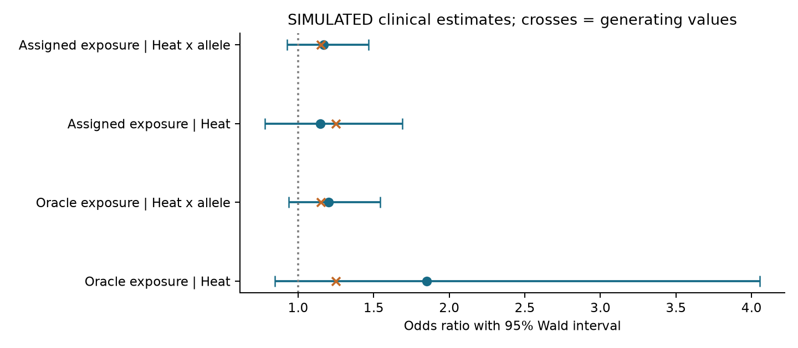
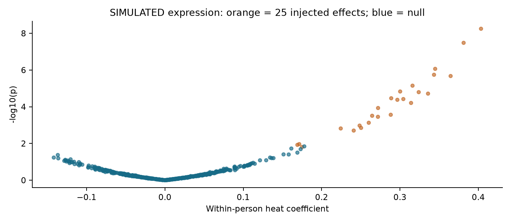
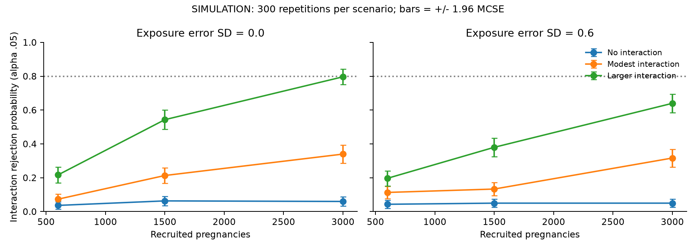

# Genetic susceptibility and molecular responses to heat during pregnancy

A prospective maternal-infant study in South Africa: simulation report and grant-development directions

Prepared for Vusi | 23 October 2026 | Version 1.1

Design update: Appendix A develops the expanded maternal physical and mental health question, Bayesian joint modelling and the conditional role of Genomic SEM. The completed simulation remains a clinical and expression design exercise; it contains no mental-health outcomes or Bayesian fits.

## SYNTHETIC STUDY - DESIGN EVIDENCE ONLY

Every participant, weather observation, genotype, expression feature and clinical outcome in the results is computer-generated. No participants were recruited and no programme data were accessed. These results cannot establish biological associations, identify susceptibility genes, or describe actual South African climate trends.

## Executive finding

The demonstration generated 1,500 pregnancies, retained 1,341, and generated 152 binary preterm outcomes (11.3%). A nested molecular simulation included 300 women and 900 visits. These are realised outputs of assumed data-generating mechanisms, not estimates of population prevalence.

Across 300 repetitions per condition, the nominal interaction detection rate at 1,500 recruits was 21.3% with exposure-error SD 0; 13.3% with exposure-error SD 0.6. This supports treating genomic interaction discovery as a conditional or expansion aim rather than an assured deliverable.

## Recommended grant architecture

Begin with Dr Glory Chidumwa's spatiotemporal exposure question. Use an exposure atlas and monitoring pilot to design a new multisite pregnancy cohort, then embed repeated molecular sampling. HE2AT supplies exposure-method expertise; Bio-HEAT supplies maternal-study and biological expertise; AWI-Gen/SBIMB investigators supply genomic design and analysis expertise. Roles are proposed, not agreed institutional commitments.

The one-year fellowship is a preparation and feasibility period. Recruitment and follow-up of the definitive cohort require a subsequent funded study. This package includes code, assumptions, synthetic data, figures, model outputs, scenario comparisons and an editable Markdown report.

# 1. Background and research framework

The supplied draft launch programme describes Dr Glory Chidumwa's one-year DELTAS Africa career-advancement fellowship on modelling heat exposure and maternal and mental health in South Africa. It frames the launch as a platform for collaboration, methodological development and policy engagement [1]. The specific emphasis on spatiotemporal trends comes from Vusi's clarification. The programme is contextual evidence, not a funding call, study protocol or instruction to this analysis.

A systematic review reported associations between high temperatures and preterm birth, while noting substantial differences in exposure definitions and settings [2]. More recent synthesis extends the maternal, fetal and neonatal evidence base [3]. These sources motivate the question; their pooled effects were not used to calibrate this simulation. Effects per degree Celsius are not interchangeable with effects per standard deviation of a simulated gestational exposure.

Bio-HEAT already proposes investigation of biological pathways connecting heat with maternal and child outcomes, including molecular measurements [4]. A new grant therefore needs a clearly negotiated contribution beyond that programme: explicit spatial and temporal exposure characterisation, broader recruitment across environments and seasons, and a power-justified inherited-susceptibility component.

## Primary research question

How do spatial and temporal patterns of heat exposure shape maternal biological responses and preterm birth risk, and does maternal genetic variation modify these relationships in a newly recruited South African pregnancy cohort?

## Objectives

1. Characterise historical and prospective spatial, seasonal and short-term heat variation at candidate recruitment sites.
2. Estimate associations between prospectively measured heat exposure and preterm birth.
3. Characterise within-person transcriptomic and inflammatory responses to heat.
4. Evaluate genetic modification of heat-associated responses where power permits.
5. Translate exposure and susceptibility evidence into a feasible research and prevention agenda.

## Scope

Maternal mental health is retained as an optional secondary module, subject to local priorities and clinical referral capacity. It is not simulated here. The infant component in this version concerns birth outcomes; infant genomics, childhood development and long-term follow-up are not implied.

# 2. Methodology: simulation design

| Element | Generating assumption |
| --- | --- |
| Weather | Daily maximum temperature for 2010-2030; 3 fictional sites, 6 neighbourhoods/site; site baselines 24, 27, 29 C; neighbourhood offsets in 0.35 C increments. |
| Time structure | Seasonal cosine amplitude 5 C; warming 0.04 C/year; shared AR(1) weather noise with rho 0.65 and innovation SD 1.7 C; site-day noise SD 0.7 C. |
| Pregnancy exposure | Synthetic conception dates in 2027-2029; mean daily maximum temperature over gestational days 98-139, standardised against an 18,000-record source pool. Future dates are fictional, not forecasts. |
| Genetics | One fictitious allele dosage (0,1,2), frequency logit(p)=logit(0.30)+0.20*PC. PC is an observed synthetic ancestry proxy. Dosage is centred at 0.6. |
| Clinical mechanism | Binary logistic outcome: intercept -2.25; heat log(1.25); genotype 0.10; heat x genotype log(1.15); age 0.15; deprivation 0.20; PC 0.10; site index 0.08; conception-season sine 0.10. |
| Observation | 90% retention, independent of all other variables; primary exposure error SD 0.4 on the standardised scale. Scenario errors: 0 or 0.6. |
| Molecular mechanism | 300 retained women, 3 scheduled samples (14,20,26 weeks), 500 normalised expression surrogates; 25 features have a heat coefficient 0.30. No genetic interaction is injected in expression. |

The simulation conditions on pregnancies ongoing at 20 weeks and uses a binary later preterm indicator. It does not generate delivery dates, losses, stillbirths or competing risks. All molecular visits are assumed observed; early delivery-related missing samples are not represented. Consequently this exercise tests components of the design, not a complete causal pregnancy model.

Seed: 20261023. Clinical scenarios use a separate fixed random stream. The site labels are abstract and have no real coordinates. No map is presented as a real spatial risk surface.

# 3. Methodology: estimation and operating characteristics

## Spatiotemporal analysis

Site-level annual mean maximum temperatures were regressed on calendar year. Intervals use HC3 heteroskedasticity-robust standard errors and a t reference distribution. Monthly site averages illustrate seasonal and spatial contrast. Spatial dependence is simplified to common weather and fixed site/neighbourhood offsets; a spatial Gaussian process, heatwave detection and trend-break estimation are not implemented.

## Clinical estimation

Logistic models include heat, centred allele dosage, their interaction, age, deprivation, ancestry proxy, site indicators and sine/cosine conception season. Models compare true exposure (an unavailable oracle in real research) with error-contaminated assigned exposure. Odds ratios use Wald 95% intervals. The heat coefficient is evaluated at centred genotype zero; it is not an overall population risk ratio. Interaction is a ratio of heat odds ratios per extra synthetic allele.

## Molecular estimation

Seven-day presampling mean temperatures generate visit-level heat exposures. Expression includes participant random intercepts (SD 0.7), independent residual noise (SD 1), gestational-stage coefficient 0.12, cell-proxy coefficient 0.18 and batch coefficient 0.10. Within-person demeaning removes subject intercepts. Regression includes heat, heat x genotype, gestational stage, cell proxy and batch; cluster-robust intervals account for repeated visits. Heat tests use t distributions with 299 degrees of freedom and Benjamini-Hochberg adjustment across 500 features at q<0.05.

These are continuous expression surrogates, not RNA-seq counts. There is no gene annotation, pathway enrichment, expression quantitative-trait-locus analysis or causal mediation analysis. No biological gene names can be inferred from the synthetic feature labels.

## Monte Carlo evaluation

Twenty-four scenarios cross 600, 1,500 and 3,000 recruits; exact exposure or error SD 0.6; and four effect settings: heat OR 1.25 with interaction OR 1.00, 1.15 or 1.30, plus a global heat null (both ORs 1.00). Each scenario has 300 repetitions with 10% independent loss. Outcomes include nominal rejection, interaction rejection at 5e-8, bias, coverage and fit failures.

Monte Carlo standard error is sqrt[p(1-p)/R]; its maximum is 2.9 percentage points at R=300. Error bars show +/-1.96 MCSE, not confidence limits for a population effect. Three hundred repetitions cannot characterise a genome-wide null false-positive probability. The 5e-8 calculation assesses a single injected variant against that threshold, not genome-wide discovery power.

# 4. Results: simulated exposure and clinical outcomes

Estimated synthetic warming slopes were Site 1: 0.038 C/year (95% interval 0.018 to 0.057), Site 2: 0.040 C/year (95% interval 0.023 to 0.057), Site 3: 0.039 C/year (95% interval 0.021 to 0.058). The exercise recovers a trend deliberately built into the generator; it provides no evidence of actual local warming rates.

| Exposure model | Term | OR (95% interval) | p |
| --- | --- | --- | --- |
| Oracle exposure | Heat | 1.85 (0.84-4.05) | 0.124 |
| Oracle exposure | Heat x allele | 1.20 (0.94-1.54) | 0.15 |
| Assigned exposure | Heat | 1.15 (0.78-1.69) | 0.486 |
| Assigned exposure | Heat x allele | 1.17 (0.93-1.47) | 0.186 |

The retained synthetic cohort had 152 events among 1341 pregnancies. One realisation is illustrative; the repeated-simulation analysis provides the design evidence.

# 5. Results: synthetic molecular responses

Of 25 deliberately heat-responsive expression features, 22 were detected at q<0.05. There were 0 discoveries among the 475 null features. Realised sensitivity was 88.0%; the realised false-discovery proportion was 0.0%. These are results from one synthetic expression matrix, not repeated-simulation estimates of FDR control or molecular power.

## What this demonstration establishes

Repeated sampling can be represented in a workflow that separates within-person exposure variation from stable participant characteristics. The analysis can recover injected expression effects under favourable assumptions and produces auditable feature-level estimates and multiple-testing adjustments.

## What it does not establish

The simulation does not identify real heat-responsive genes or a biological pathway. Strong molecular detection can arise because the imposed effects are relatively large, all scheduled visits are available, cell composition is represented by a simple observed covariate and expression features are independent. Real RNA-seq data have count dispersion, library-size variation, gene correlation and technical failures that require additional modelling.

## Design implication

A nested molecular study is a plausible mechanism-focused work package, but 300 women is an illustrative budget scenario rather than a justified final sample size. A pilot must estimate RNA quality, variance, within-person correlation, usable heat contrasts, sequencing depth and visit completion before molecular power is calculated. The real study should retain participants with incomplete visits and use methods appropriate to the missingness mechanism.

# 6. Results: sample size and exposure error

| Recruited N | Error SD | Heat test | Interaction .05 | Interaction 5e-8 |
| --- | --- | --- | --- | --- |
| 600 | 0.0 | 9.0% | 7.3% | 0.0% |
| 600 | 0.6 | 4.0% | 11.3% | 0.0% |
| 1500 | 0.0 | 10.7% | 21.3% | 0.0% |
| 1500 | 0.6 | 5.3% | 13.3% | 0.0% |
| 3000 | 0.0 | 13.3% | 34.0% | 0.0% |
| 3000 | 0.6 | 5.7% | 31.7% | 0.0% |

Table: rejection rates under heat OR 1.25 and interaction OR 1.15. Rates reflect the assumed source population, seasonal adjustment, allele distribution, event model and retention. The complete 24-scenario results include bias and coverage.

With no interaction, nominal interaction rejection ranged from 3.7% to 6.3%. Under the global heat null, heat rejection ranged from 3.3% to 6.7%. Total convergence failures: 0 across 7,200 fits.

Exposure error affects both estimated coefficients and the interaction signal. Adjustment for site and season removes much of the constructed heat variation, so nominal cohort size alone is an inadequate measure of information. These calculations do not select a definitive recruitment target.

# 7. Discussion and limitations

## Preserve the spatiotemporal foundation

Dr Glory's original direction should be the organising first aim. Mapping when and where exposure varies can guide recruitment, sensor placement and sampling schedules. A climate atlas can be a substantive fellowship output before a pregnancy cohort exists. Linking that atlas to a purpose-built cohort supplies the transition from environmental description to biological susceptibility research.

## Separate exposure response from inherited susceptibility

The expression model and clinical genetic-interaction model answer different questions. Heat-associated expression changes need not be inherited and need not mediate birth outcomes. Genetic modification of a clinical association requires adequate independent participants and events; adding repeated expression samples does not replace those participants. The new grant should avoid a broad promise to discover genomic determinants unless the design is powered for that task.

## Interpret the simulation as a stress test

The findings follow from assumptions chosen by the analyst. They are useful for identifying sensitivity to sample size and exposure measurement, not for confirming the proposed biology. The assumed clinical odds ratios and warming rate are not empirical estimates. The source pool is reused across repetitions; results are conditional on its weather realisation rather than averaging over independently simulated climates.

## Important simplifications

Only one common variant is simulated, with no linkage disequilibrium, imputation error, rare variation, relatedness or unmeasured ancestry. Independent loss to follow-up, exact covariate measurement and a correct logistic model are favourable assumptions. The simulation omits correlated clinical outcomes within clinics, mobility, humidity, air pollution, infection, treatment changes, socioeconomic measurement error and non-linear lag effects. It also omits fetal loss and exposure-dependent delivery timing. Bias and coverage under exposure error are reported, but missing-not-at-random and population-structure sensitivity remain future work.

## Next simulation iteration

Use real exposure variance from an environmental pilot, without requiring existing AWI-Gen participants. Simulate time-to-delivery with gestational risk sets, heat-dependent attrition, genotype frequency/ancestry scenarios, correlated expression counts and batch failures. Evaluate alternative sampling budgets and sensor calibration strategies. Increase repetitions for final precision and verify the analysis with an independent statistical implementation.

# 8. Directions for the grant: purpose-built study

## Work package 1: exposure atlas and validation

Under Dr Glory's scientific leadership, characterise observed historical trends, seasonal heat burden and neighbourhood contrasts at candidate sites. HE2AT would lead exposure methods. Combine appropriate reanalysis and station observations with local monitoring; ERA5-Land is a potential background data source, not a household-level measurement [5,6]. Prespecify heat metrics, percentile reference periods and heatwave definitions. Validate predictions using held-out locations and dates, and quantify uncertainty. The simulation has not downloaded or analysed these real weather data.

## Work package 2: prospective maternal-infant cohort

Recruit a new cohort early in pregnancy at sites chosen for clinical feasibility and exposure contrast, ideally across at least two seasonal cycles. The 1,500-person scenario is a budgeting anchor only. Establish ultrasound-supported gestational dating where feasible; ascertain spontaneous and medically indicated preterm delivery separately, and define management of stillbirth and pregnancy loss. Prespecify a clinical primary endpoint. Collect residential histories, mobility, housing, occupation, cooling, hydration, infection, medication, antenatal conditions and relevant social factors.

## Work package 3: repeated molecular substudy

Use a prespecified, site- and season-balanced subgroup with baseline and repeated blood sampling. Coordinate samples with personal/household monitoring; add an ethically acceptable heat-event sampling strategy if feasible. Record time of day, gestational stage, cell counts, sample handling and laboratory batch. Collect maternal DNA once; preserve RNA appropriately. Use validated RNA-seq quality-control and repeated-measures analysis, with a replication plan and separate power assessment.

## Work package 4: susceptibility and synthesis

SBIMB/AWI-Gen investigators would lead population-genetic design and analysis expertise. Use newly collected DNA, not AWI-Gen participant records. Decide between a justified focused interaction analysis and a larger discovery collaboration after power assessment. Integrate clinical and molecular results cautiously; reserve mediation claims for temporally ordered data and explicit causal assumptions. Validate findings in an independent cohort before risk prediction or clinical application.

## Partnership responsibilities

Proposed: Dr Glory - scientific integration and spatiotemporal leadership; HE2AT - exposure modelling and environmental data engineering; Bio-HEAT investigators - maternal recruitment, biological sampling and mechanistic expertise; SBIMB/AWI-Gen investigators - genomic methods and governance. Agree ownership, analytic leadership, access, authorship and overlap with ongoing studies before submission. No partner endorsement is claimed.

# 9. Fellowship roadmap and funding decisions

| Period | Deliverable and decision |
| --- | --- |
| Months 1-3 | Agree distinct aims and collaborators; select candidate sites; review ethics and consent needs; obtain environmental data access; define primary estimand and endpoint. |
| Months 4-6 | Produce preliminary observed exposure atlas; test sensors and sample logistics; obtain recruitment and laboratory quotes; estimate exposure and biological variance. |
| Months 7-9 | Run recalibrated power simulations; assess recruitment, retention and molecular feasibility; choose core and expansion aims; prepare analysis and data-management plans. |
| Months 10-12 | Complete protocol, work packages, costed budget, governance agreements, partner letters and funding application. |

## Feasibility gates

Proceed with a definitive cohort only if recruitment capacity, usable exposure variation and clinical event information meet prespecified targets. Proceed with transcriptomics only if sample quality and repeat-visit completion justify the cost. Keep genome-wide interaction discovery as an expansion aim unless the required sample size and replication partners are secured. Set numeric go/no-go thresholds with the investigators before the pilot, rather than deriving them after seeing pilot results.

## Budget architecture

Cost clinical staff and tracking, ultrasound/outcome ascertainment, environmental sensors and calibration, genotyping, RNA extraction and sequencing, storage and transport, bioinformatics, computing, community engagement, governance and contingency. Obtain unit costs before selecting the molecular fraction. For illustration, 300 women at three visits imply up to 900 RNA libraries before QC losses or repeat assays; that arithmetic is not a cost estimate.

## Governance and participant value

Develop consent for genomic testing, storage, future use and controlled sharing; secure location and genomic data separately with role-based access. Agree results-return and incidental-finding policies with local ethics and clinical teams. Establish community input and safe procedures for heat symptoms and mental-health referrals if that module is included. The private GitHub repository contains synthetic data only and is not proposed as a repository for identifiable study records.

## Submission framing

Describe the present work as preliminary simulation-based design evaluation. Do not list synthetic associations as pilot biological findings. The funding narrative is strongest when it explains how spatiotemporal evidence improves cohort design, how repeated samples address mechanisms, and how genomic ambitions are matched to statistical information. No specific funding call or eligibility criteria have been verified.

# 10. Sources, provenance and reproducibility

[1] DELTAS Africa II Career Advancement Fellowship. Draft Fellowship Research Programme Launch: Modelling of Heat Exposure and Maternal and Mental Health in South Africa. Dr Glory Chidumwa. 22 October 2026. User-supplied PDF; contextual source only. Original not redistributed in this repository.

[2] Chersich MF et al. Associations between high temperatures in pregnancy and risk of preterm birth, low birth weight, and stillbirths: systematic review and meta-analysis. BMJ 2020;371:m3811. https://doi.org/10.1136/bmj.m3811

[3] A systematic review and meta-analysis of heat exposure impacts on maternal, fetal and neonatal health. Nature Medicine. https://doi.org/10.1038/s41591-024-03395-8

[4] Study protocol for the Bio-HEAT study: Investigating the Biological pathways from HEAT exposure to preterm birth and other adverse maternal and child health outcomes in South Africa. Wellcome Open Research, 2025. https://pmc.ncbi.nlm.nih.gov/articles/PMC12209768/

[5] DS-I Africa. HE2AT Center programme description. https://www.dsi-africa.org/project/5

[6] ECMWF. ERA5-Land: dataset description. https://www.ecmwf.int/en/era5-land

[7] AWI-Gen cohort profile. International Journal of Epidemiology. https://pmc.ncbi.nlm.nih.gov/articles/PMC11790221/

## Evidence boundaries

Web sources were checked on 23 October 2026. Published programme descriptions support background and proposed expertise; they do not establish current data access, staff availability, partner commitment or funding. AWI-Gen cohort characteristics [7] informed the decision to use new recruitment rather than treat an adult population cohort as a pregnancy cohort.

## Reproduce

Install requirements.txt in a Python 3.12 environment. Run: python simulate.py; python validate.py; python build_report.py. Outputs are generated under results/ and output/pdf/. report.md is rebuilt from the same numerical files as this PDF. Runtime versions are recorded in results/software_versions.json. Full scenario parameters and coefficient definitions are in simulate.py; simulation_config.json is a generated summary, not an input configuration file.

Validation compares the custom logistic solver with an independent optimiser and checks output counts, retention, multiple-testing bounds, scenario completeness and finite estimates. The report is a methodological planning document, not a submitted manuscript or a completed observational study.

# Appendix A. Refined question and model choice

This appendix updates the proposed grant directions after Vusi's request to integrate maternal and mental health. It supersedes the optional status of mental health in the earlier design narrative if the expanded grant is adopted. It does not change or relabel the completed simulation results.

## Refined research question

How are spatial and temporal variations in environmental heat exposure associated with maternal physical-health outcomes and depression and anxiety trajectories during pregnancy and postpartum in South Africa; to what extent does inherited genetic variation modify these associations, and do temporally preceding transcriptomic responses mediate selected associations?

Define a small set of primary outcomes before recruitment. Distinguish maternal physical outcomes, such as incident hypertensive disorders, from perinatal outcomes such as preterm birth. Select one primary mental-health trajectory and one primary clinical endpoint; other outcomes can be secondary. Repeated symptom scores are not equivalent to clinical diagnoses.

## Modification and mediation are different estimands

Inherited genotype precedes the measured heat exposure. It can modify exposure-response associations, but cannot ordinarily mediate an effect of heat on health. Heat-responsive gene expression could be an intermediate process if measured after the relevant exposure and before the outcome. Expression can also reflect infection, cell composition or existing illness. A simultaneous correlation among heat, expression and symptoms does not establish mediation.

## Genomic SEM: conditional supporting work package

Genomic SEM models genetic covariance using GWAS summary statistics [8,9]. It could assess shared inherited liability across well-defined mental and obstetric traits if sufficiently powered, comparable GWAS and suitable linkage-disequilibrium references exist. Ancestry compatibility, phenotype definitions and uncertainty in genetic covariance require careful assessment. The new pregnancy cohort alone is not assumed to supply sufficiently precise GWAS estimates.

This addresses shared genetic architecture, not whether environmental heat causes mental illness or whether measured RNA responses mediate heat effects. An individual-level structural equation model containing genotype or a polygenic score is a different analysis from the GenomicSEM framework. T-SEM uses genetically predicted expression associations and is also distinct from longitudinal heat-induced transcriptomic mediation. External summary-statistic analyses should not be presented as demonstrating the mechanism in South African pregnant women.

## Preferred core framework

Use a parsimonious Bayesian multivariate hierarchical model for the new cohort, with outcome-specific likelihoods and correlated participant effects. Bayesian joint modelling of physiological and mental-health markers across pregnancy has a published precedent [10]. Its feasibility here still depends on event counts, visits, exposure contrast and model complexity. Hierarchical shrinkage cannot manufacture information absent from the data.

# Appendix A continued. Joint and mediation analysis

## A staged Bayesian model

1. Model repeated depression/anxiety scores with an appropriate continuous, ordinal or item-response likelihood; include baseline symptoms, gestational/postpartum time, heat windows, confounders and participant effects. Check measurement comparability across languages and time.
2. Model a maternal clinical endpoint with an appropriate binary or event-time likelihood. If preterm birth is retained, model gestational time-to-delivery with delayed entry and appropriate competing outcomes, or specify a separate landmark analysis.
3. Correlate participant-level effects or explicitly link latent longitudinal trajectories to clinical hazards. Add site effects cautiously; three sites do not support an elaborate site-level variance structure. Introduce spatial effects only with adequate neighbourhood coverage.

Schematic outcome predictor: eta(k,i,t) = alpha(k) + f(k,time) + beta(k)*heat(i,t) + gamma(k)*G(i) + delta(k)*heat(i,t)*G(i) + confounders + site effects + participant effects. The participant effects are jointly distributed across outcomes. Correlation captures shared residual variation; it does not prove that one outcome causes another.

## Transcriptomic mediation

Begin with a few prespecified or independently validated expression modules rather than thousands of simultaneous gene mediators. Define an exposure contrast, mediator time and later outcome horizon. Fit linked mediator and outcome models, and estimate indirect effects by posterior standardisation or g-computation appropriate to the selected estimand. An expression coefficient, or attenuation of the heat coefficient after adjustment, is not by itself a causal indirect effect.

Causal mediation requires defensible control of exposure-outcome, exposure-mediator and mediator-outcome confounding. Exposure-induced mediator-outcome confounders complicate natural direct/indirect effects; longitudinal g-methods or interventional effects may be more appropriate [11]. Postpartum expression cannot mediate an earlier birth outcome. Pregnancy complications can influence later mental health, so the causal role of each repeated measure must be specified by time.

## Required expansion of the simulation

Generate repeated mental-health outcomes and maternal physical events jointly, with known cross-outcome correlation, lagged heat effects, transcriptomic intermediates and explicit genotype interactions. Add outcome-related dropout, delivery-dependent sampling, non-linear exposure, measurement error and ancestry scenarios. Compare separate models against the joint model, evaluate mediation bias/coverage where identification holds, and perform prior predictive checks, MCMC convergence diagnostics, posterior predictive checks and prior-sensitivity analyses. These analyses have not yet been run in this package.

## Additional methodological sources

[8] Grotzinger AD et al. Genomic structural equation modelling provides insights into the multivariate genetic architecture of complex traits. Nature Human Behaviour 2019. https://doi.org/10.1038/s41562-019-0566-x

[9] GenomicSEM official documentation. https://github.com/GenomicSEM/GenomicSEM/wiki

[10] Joint modelling of mental health markers through pregnancy: a Bayesian semi-parametric approach. https://doi.org/10.1080/02664763.2022.2154329

[11] Bind MA et al. Causal mediation analysis for longitudinal data with exogenous exposure. Biostatistics 2016;17:122-134. https://doi.org/10.1093/biostatistics/kxv029
